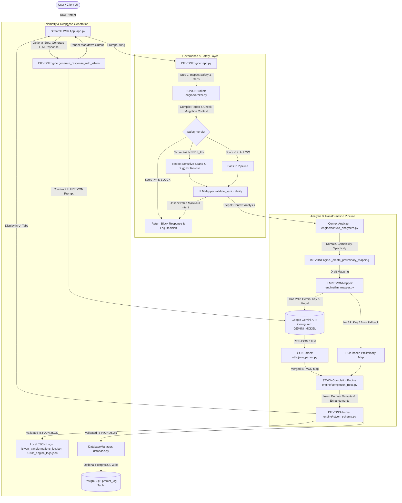

# Architecture: ISTVON Prompt Enhancement Engine

## 1. Purpose & Scope
The **ISTVON Prompt Enhancement Engine** is a dual-tier prompt engineering, governance, and transformation system designed for developers, enterprise AI operators, and end-users who need to convert ambiguous, unstructured natural language prompts into deterministic, machine-readable, and guardrailed prompt specifications. It solves the unpredictability, prompt injection vulnerabilities, and incomplete context of raw LLM prompts by enforcing the **ISTVON** structural framework (**I**nstructions, **S**ources, **T**ools, **V**ariables, **O**utcome, **N**otifications) paired with **COSTAR** gap analysis, two-stage safety brokerage (RegEx heuristic filtering + LLM semantic sanitizability validation), and seamless offline fallback execution.

---

## 2. Architecture Overview

### High-Level Component Diagram


### Component Communication Mechanisms
1. **Synchronous In-Process Function Calls**: All core processing hops (`app.py` → `ISTVONEngine` → `ISTVONBroker` → `ContextAnalyzer` → `LLMISTVONMapper` → `ISTVONCompletionEngine` → `ISTVONSchema`) execute synchronously within the Python runtime.
2. **External HTTP / REST API (Google Gemini)**: `LLMISTVONMapper` (shared by `ISTVONEngine.generate_response_with_istvon`) calls Google's Gemini API using the `google-genai` SDK (`genai.Client`) over HTTPS with `HttpOptions` timeouts.
3. **Database Protocol (TCP/IP via libpq/psycopg2)**: `DatabaseManager` connects to PostgreSQL via `psycopg2` using connection pooling parameters or a `DATABASE_URL` connection string.
4. **Local Append-Only File Streams**: Synchronous file writes append line-delimited JSON objects to `rule_engine_logs.json` and `istvon_transformations_log.json`.

### State Lifecycle and Flow
- **Streamlit Session State (`st.session_state`)**: Manages the transient UI state across user interactions. Keys include `istvon_result` (the structured mapping and broker metadata), `original_prompt` (user input string), and `generated_response` (LLM-generated output text).
- **Processing State (`dict`)**: Passed down the pipeline as an evolving dictionary containing `I`, `S`, `T`, `V`, `O`, `N` structures, context metadata (`domain`, `complexity`, `specificity`), and broker decisions (`verdict`, `reason`, `sanitized_prompt`).
- **Telemetry State**: Persisted across two audit trails:
  - Local JSON lines (`rule_engine_logs.json` and `istvon_transformations_log.json`).
  - Relational PostgreSQL database (`prompt_log` table) when connection credentials exist.

---

## 3. Tech Stack & Why

| Technology | Version / Spec | Purpose & Architectural Justification |
| :--- | :--- | :--- |
| **Python** | 3.9+ (tested 3.11.9) | Core language. Selected for ecosystem compatibility with AI libraries, regex performance, and rapid string manipulation. |
| **Streamlit** | `1.28.0` | Frontend web interface. Chosen to avoid complex React/Node.js build pipelines while providing reactive UI components (session state, tabs, JSON viewers, file downloads). |
| **NumPy / PyArrow** | `numpy<2,>=1.19.3`, `pyarrow>=6.0,<26` | Transitive data stack for Streamlit `1.28.0`. Pinned below `pyarrow 26` and `numpy 2.0` to prevent `pyarrow` ABI/import conflicts with `numpy 1.x`. |
| **Google GenAI SDK** | `google-genai>=1.0.0` | Official GA LLM client (`genai.Client`) for Google Gemini models (uses `GEMINI_MODEL` from environment). Provides JSON-mode prompt completion, semantic sanitizability validation, and `HttpOptions` request timeouts. |
| **psycopg2-binary** | `>=2.9.0` | PostgreSQL client driver. Chosen for native JSONB indexing support, parameterized queries, and low-latency database telemetry. |
| **python-dotenv** | `1.0.0` | Environment variable loader. Isolates secrets (`GEMINI_API_KEY`, DB credentials) from source code (`override=True`), with a manual fallback parser in `config.py` if the library is absent. |
| **re** | Standard Library | Pattern matching engine. Drives safety heuristic scoring, mitigation window context checks, allowlist span filtering, keyword extraction, and COSTAR gap analysis. |
| **Pytest** | `pytest>=8.0.0` | Automated test runner. Executes 44 unit tests covering broker logic, `google-genai` client initialization/mocking, fallback merging, regex parsers, placeholder checks, and schema validation. |

---

## 4. Directory & Module Map

```
ISTVON_Prompt_Enhancement_Engine/
├── .env.example
├── .gitignore
├── README.md
├── app.py
├── config.py
├── database.py
├── demo.py
├── requirements.txt
├── docs/
│   └── ARCHITECTURE.md
├── engine/
│   ├── __init__.py
│   ├── broker.py
│   ├── completion_rules.py
│   ├── context_analyzers.py
│   ├── istvon_schema.py
│   ├── llm_mapper.py
│   └── pattern_matchers.py
├── utils/
│   ├── __init__.py
│   ├── helpers.py
│   ├── json_logger.py
│   ├── json_parser.py
│   ├── logger.py
│   └── validators.py
├── tests/
│   ├── test_broker.py
│   ├── test_llm_mapper.py
│   └── test_rules.py
├── examples/
│   ├── sample_outputs.json
│   └── sample_prompts.txt
└── exports/
```

### Module Responsibilities & Misleading Name Flags
- **`app.py`**: Streamlit web entry point and orchestration controller (`ISTVONEngine`).
- **`config.py`**: Central configuration registry; loads `.env`, defines the static `ISTVON_SCHEMA` template, and holds domain-specific presets.
- **`database.py`**: PostgreSQL database client and telemetry logger. Implements self-healing table setup and graceful silent degradation when the database is unavailable.
- **`demo.py`**: Minimal standalone script demonstrating PostgreSQL `prompt_log` setup and insertion via `DatabaseManager` using environment configuration.
- **`engine/broker.py`**: Core safety filter and COSTAR gap analyzer. Classifies prompts into `ALLOW`, `NEEDS_FIX`, or `BLOCK` using severity-weighted regex matching and context-window mitigation indicators.
- **`engine/llm_mapper.py`**: Gemini API integration layer. Builds structural prompts, invokes LLM transformation, merges LLM outputs with rule-based drafts, and runs safety validation.
- **`engine/context_analyzers.py`**: Heuristic context detector. Calculates domain (`technical`, `business`, `creative`, `academic`, `communication`), complexity level (`simple`, `medium`, `complex`), and specificity scores.
- **`engine/pattern_matchers.py`**: RegEx-based extraction engine for extracting preliminary instructions, sources, tools, variables, outcomes, and notifications directly from raw prompt text.
- **`engine/completion_rules.py`**: Deterministic rule-based completion engine. Fills in missing ISTVON keys and injects domain-specific best-practice instructions and success criteria.
- **`engine/istvon_schema.py`**: Schema enforcement layer. *(Flag: Misleading name — not a Pydantic Model or JSON-Schema library validator, but a hand-rolled dictionary type and required-key enforcer)*.
- **`utils/json_parser.py`**: Robust JSON extraction and sanitization utility. Extracts JSON blobs from conversational LLM output and strips malicious HTML/script injections.
- **`utils/json_logger.py`**: Appends newline-delimited JSON audit logs to `rule_engine_logs.json`.
- **`utils/logger.py`**: Standard Python `logging` wrapper for stdout diagnostic logs.
- **`utils/helpers.py`**: Formatting utilities (timestamps, text truncation) and sample prompt repository (`ExamplePrompts`).
- **`utils/validators.py`**: Basic helper functions for JSON syntax and character sanitization. *(Flag: Partially redundant with `utils/json_parser.py`)*.
- **`tests/`**: Unit test suite with mock support for offline testing.

---

## 5. Critical Files (The Load-Bearing Core)

### 1. `app.py`
- **Why it's critical**: Central orchestration engine and interactive user interface. Houses `ISTVONEngine`, which connects safety checks, LLM enhancement, fallback logic, telemetry logging, and secondary response generation.
- **Key Functions/Classes**:
  - `ISTVONEngine`: Main pipeline orchestrator.
  - `ISTVONEngine.process_prompt(prompt)`: Executes the 9-step prompt transformation pipeline.
  - `ISTVONEngine.generate_response_with_istvon(original_prompt, istvon_data)`: Re-prompts Gemini using the complete ISTVON specification as a structured system constraint.
  - `log_istvon_transformation(...)`: Writes end-to-end execution logs to `istvon_transformations_log.json`.
  - `main()`: Streamlit reactive UI lifecycle controller.
- **Non-Obvious Details**:
  - `process_prompt` executes a **two-phase safety check**: Phase 1 is the local Regex Broker (`ISTVONBroker`), and Phase 2 is an LLM-based semantic validator (`LLMISTVONMapper.validate_sanitizability`).
  - When a prompt is blocked at Phase 2, `app.py` directly instantiates `RuleEngineLogger` to write a local log entry before halting.

### 2. `engine/broker.py`
- **Why it's critical**: The primary safety governance and prompt completeness evaluation engine. Enforces security boundaries and performs COSTAR gap analysis.
- **Key Functions/Classes**:
  - `BrokerDecision(Enum)`: Enum with values `ALLOW`, `NEEDS_FIX`, `BLOCK`.
  - `ISTVONBroker.__init__()`: Precompiles regex pattern maps for malicious, inappropriate, sensitive, and dangerous categories alongside allowlists and mitigation keywords.
  - `ISTVONBroker.analyze_prompt(prompt)`: Evaluates safety risks and COSTAR completeness.
  - `ISTVONBroker._analyze_safety(prompt)`: Calculates numeric severity score with a **40-character window-based mitigation check** (e.g., reduces score if preceded by words like "prevent" or "secure").
  - `ISTVONBroker.process_with_broker(prompt)`: Orchestrates analysis, logging, sanitization (redaction), and enhancement.
  - `ISTVONBroker._sanitize_prompt(prompt, analysis)`: Performs span-based redactions replacing risky tokens with `[REDACTED]` and suggests rephrasing.
- **Non-Obvious Details**:
  - Allowlist patterns (e.g., `ethical hacking`, `penetration testing`, `prevent phishing`) suppress only overlapping unsafe pattern spans rather than short-circuiting the entire prompt, so unrelated dangerous or malicious terms elsewhere in the prompt are still evaluated.
  - If matches span ≥ 2 distinct unsafe categories, an extra multi-category penalty bonus is added to `total_score`, triggering an immediate `BLOCK`.
  - COSTAR gaps do **not** block or force `NEEDS_FIX` on an otherwise safe prompt; they only produce structured UI recommendations.

### 3. `engine/llm_mapper.py`
- **Why it's critical**: Manages all interactions with the Google Gemini API, including structural prompt generation, LLM response extraction, dictionary merging, and safety sanitizability classification.
- **Key Functions/Classes**:
  - `LLMISTVONMapper.__init__(api_key=_UNSET, model_name=_UNSET)`: Initializes `google.genai.Client` (configured with millisecond `types.HttpOptions`) using a sentinel `_UNSET` pattern to distinguish between unpassed arguments and explicit `None` (vital for test isolation).
  - `LLMISTVONMapper.enhance_mapping(natural_prompt, preliminary_map, context)`: Sends structured instructions to Gemini to complete missing ISTVON elements, falling back to rule-based mapping on any failure.
  - `LLMISTVONMapper._merge_mappings(rule_based, llm_enhanced)`: Intelligently merges rule-based dictionary keys and LLM-generated dictionary keys while preserving insertion order.
  - `LLMISTVONMapper.validate_sanitizability(prompt)`: Uses Gemini to identify social engineering, phishing, credential harvesting, or guardrail bypass attempts hidden behind benign framing (e.g., "for educational research").
- **Non-Obvious Details**:
  - In `_merge_mappings`, list values (such as `I` and `T`) are deduplicated using order-preserving logic to maintain correct sequential execution steps.

### 4. `engine/context_analyzers.py`
- **Why it's critical**: Provides deterministic classification of prompt intent, domain, complexity, and specificity without requiring LLM calls.
- **Key Functions/Classes**:
  - `ContextAnalyzer.analyze_prompt_context(prompt)`: Returns domain, complexity tier, specificity rating, and domain-specific rules.
  - `ContextAnalyzer._identify_domain(prompt)`: Keyword frequency analysis across `technical`, `business`, `creative`, `academic`, and `communication`. Defaults to `general`.
  - `ContextAnalyzer._assess_complexity(prompt)`: Scores prompt complexity using mutually exclusive single-word lists, multi-word phrase bonuses (weight 2), and word-count thresholds (>40 words → complex).
  - `ContextAnalyzer._measure_specificity(prompt)`: Computes normalized score based on word density and precision indicators (`exact`, `particular`, etc.).
- **Non-Obvious Details**:
  - Keyword lists are strictly lowercased and matched against `prompt.lower()`. Domain assignment uses `max()`, defaulting to the first maximum in case of ties.

### 5. `engine/completion_rules.py`
- **Why it's critical**: Guarantees that even if the LLM fails, disconnects, or returns partial JSON, the resulting ISTVON structure has required instruction quality, tool definitions, variables, and success criteria.
- **Key Functions/Classes**:
  - `ISTVONCompletionEngine.apply_completion_rules(partial_map, context)`: Master completion function.
  - `ISTVONCompletionEngine._enhance_instructions(instructions, context)`: Injects domain-specific quality rules (e.g., "Ensure code quality and best practices" for `technical`).
  - `ISTVONCompletionEngine._enhance_outcome(outcome, context)`: Injects standard domain success criteria into the `O` key.
  - `ISTVONCompletionEngine._apply_domain_defaults(istvon_map, domain_rules)`: Merges default domain tools into `T`.
- **Non-Obvious Details**:
  - Always enforces at least one instruction in `I` (`"Execute the requested task effectively"` if empty) and guarantees required `O` keys (`format`, `delivery`, `success_criteria`).

### 6. `utils/json_parser.py`
- **Why it's critical**: Prevents malformed LLM responses from crashing the application and cleans dangerous HTML/XSS vectors from LLM outputs.
- **Key Functions/Classes**:
  - `JSONParser.parse_gemini_response(response_text)`: 4-stage pipeline (Extract → Safe Parse → Structure Validate → Sanitize).
  - `JSONParser._extract_json(text)`: Balanced bracket extraction of JSON blobs enclosed in `{...}` or `[...]` to discard conversational markdown wrapper text without greedy regex truncation.
  - `JSONParser._sanitize_text(text)`: Aggressive 4-step sanitizer removing dangerous tags (`<script>`, `<iframe>`, `<style>`) including their internal contents, followed by remaining HTML tags and special characters (`<`, `>`, `"`, `'`, `&`, `;`).
  - `JSONParser.is_valid_istvon(data)`: Validates mandatory existence and types of keys `I` and `O`.
- **Non-Obvious Details**:
  - The sanitizer explicitly strips single and double quotes (`"` and `'`), which can alter prompt grammar if used directly on prompt instructions.

### 7. `database.py`
- **Why it's critical**: Provides enterprise-grade PostgreSQL telemetry logging, analytics aggregation, and audit persistence.
- **Key Functions/Classes**:
  - `DatabaseManager.setup_database()`: Creates table `prompt_log` with `JSONB` support and timestamp/verdict indexes.
  - `DatabaseManager.log_transformation(...)`: Inserts full audit records with timestamp, original prompt, verdict, reason, sanitized prompt, final response, and `istvon_map_json`.
  - `DatabaseManager.get_analytics()`: Computes aggregate metrics (`total_transformations`, `avg_prompt_length`, `success_rate`).
  - `DatabaseManager.import_from_json_file(json_filepath)`: Ingests existing JSON log exports directly into PostgreSQL.
- **Non-Obvious Details**:
  - `DatabaseManager` wraps all connection and query failures in `try/except` blocks that print warnings but **never raise exceptions**, ensuring database downtime never interrupts prompt enhancement.

---

## 6. Data & Control Flow (End-to-End)

### Step-by-Step Flow: Prompt Input to Final Response Generation

```
[1] User inputs prompt in Streamlit UI:
    "Write a python script to parse CSV files and calculate mean values"
    │
    ▼
[2] User clicks "🔄 Enhance with ISTVON" -> Triggers app.py: ISTVONEngine.process_prompt()
    │
    ├──> [Step 2.1] Safety Broker: ISTVONBroker.process_with_broker() (engine/broker.py)
    │    ├── Calls _analyze_safety() -> Evaluates compiled regex categories (malicious, dangerous, etc.)
    │    │   └── Check mitigation window -> Score = 0 -> Verdict = ALLOW
    │    ├── Calls _analyze_costar_gaps() -> Checks missing elements (context, timeline, audience)
    │    └── Calls context_analyzer.analyze_prompt_context() -> Domain = "technical"
    │
    ├──> [Step 2.2] LLM Sanitizability Check: LLMISTVONMapper.validate_sanitizability() (engine/llm_mapper.py)
    │    └── Calls Gemini with strict social engineering / harm rejection rules -> Returns sanitizable: True
    │
    ├──> [Step 2.3] Context Analysis: ContextAnalyzer.analyze_prompt_context() (engine/context_analyzers.py)
    │    └── Returns: domain="technical", complexity="medium", specificity="medium", domain_rules={...}
    │
    ├──> [Step 2.4] Preliminary Mapping: ISTVONEngine._create_preliminary_mapping() (app.py)
    │    └── Seeds default tools: ["Code formatting", "Documentation standards", "Technical writing"]
    │
    ├──> [Step 2.5] LLM Transformation: LLMISTVONMapper.enhance_mapping() (engine/llm_mapper.py)
    │    ├── Builds prompt with ISTVON schema contract and domain context
    │    ├── Calls client.models.generate_content() (JSON mode) -> receives JSON response string
    │    ├── Calls _parse_llm_response() -> extracts dictionary
    │    └── Calls _merge_mappings() -> merges preliminary + LLM keys
    │
    ├──> [Step 2.6] Deterministic Completion: ISTVONCompletionEngine.apply_completion_rules() (engine/completion_rules.py)
    │    ├── Enhances instructions: Appends technical quality standards
    │    ├── Enhances outcome: Injects "Technically accurate", "Well-structured code/documentation"
    │    └── Fills missing variables: {"complexity": "Technical", "format": "Markdown/Code"}
    │
    ├──> [Step 2.7] Schema Validation: ISTVONSchema.validate_istvon() (engine/istvon_schema.py)
    │    └── Enforces array/dict types on all 6 keys, returning finalized dictionary
    │
    ├──> [Step 2.8] Database Telemetry: DatabaseManager.log_transformation() (database.py)
    │    └── Executes INSERT INTO prompt_log (PostgreSQL) if connected
    │
    └──> [Step 2.9] Local Audit Logging: log_istvon_transformation() (app.py)
         └── Appends JSON line to istvon_transformations_log.json
    │
    ▼
[3] UI Render (app.py):
    - Displays Verdict ("ALLOW"), Reason ("Safe to proceed"), Processing Time (e.g. 3865 ms)
    - Renders Tab 1: Formatted ISTVON JSON + Download button
    - Renders Tab 2: Processing metrics
    │
    ▼
[4] User clicks "✅ Yes, Generate Response" -> Triggers ISTVONEngine.generate_response_with_istvon()
    │
    ├──> [Step 4.1] Compiles Full ISTVON Prompt:
    │    - PRIMARY USER REQUEST: "Write a python script to parse CSV files and calculate mean values"
    │    - SUPPORTING ISTVON FRAMEWORK: Formatted Instructions, Sources, Tools, Variables, Expected Outcome
    │
    ├──> [Step 4.2] Calls Gemini API:
    │    └── self.llm_mapper.generate_response(full_prompt, ...) -> client.models.generate_content() -> Returns completed markdown response
    │
    ├──> [Step 4.3] Audit Logging Update:
    │    └── Appends combined payload (original prompt + ISTVON spec + final LLM code) to istvon_transformations_log.json
    │
    ▼
[5] Output Display:
    - Renders Markdown response (working Python script with error handling and pandas)
    - Enables "📥 Download ISTVON + Response JSON" button
```

---

## 7. Configuration & Environment

Configuration is managed via `config.py`, which loads `.env` next to `config.py` using `python-dotenv` with `override=True` (so project `.env` values take precedence over ambient OS variables; if `python-dotenv` is missing, an internal parser applies the same behavior).

### Configuration Parameters
| Parameter | Env Var Name | Default Value | Description / Failure Mode |
| :--- | :--- | :--- | :--- |
| `GEMINI_API_KEY` | `GEMINI_API_KEY` | `None` | Google Gemini API Key. If missing or a placeholder (`your_gemini_api_key_here`, `your-api-key-here`, etc.), LLM features disable automatically and the engine operates entirely in offline rule-based mode. |
| `DEFAULT_MODEL` | `GEMINI_MODEL` | `""` *(empty string)* | Target Gemini model. If unset, a placeholder (`your_gemini_model_here`), or an invalid model ID, LLM initialization skips or falls back to rule-based mappings. |
| `POSTGRES_HOST` | `POSTGRES_HOST` | `localhost` | PostgreSQL hostname. |
| `POSTGRES_PORT` | `POSTGRES_PORT` | `5432` | PostgreSQL port number. |
| `POSTGRES_DB` | `POSTGRES_DB` | `istvon_db` | Target PostgreSQL database name. |
| `POSTGRES_USER` | `POSTGRES_USER` | `postgres` | PostgreSQL username. |
| `POSTGRES_PASSWORD` | `POSTGRES_PASSWORD` | `""` | PostgreSQL user password. |
| `DATABASE_URL` | `DATABASE_URL` | `""` | Complete PostgreSQL connection URI (takes precedence over individual host/port vars). |
| `MAX_PROMPT_LENGTH` | *(Static)* | `5000` | Maximum character length allowed in the Streamlit UI text area. |
| `DEFAULT_TIMEOUT` | *(Static)* | `30` | Default network request timeout in seconds (passed as `Config.DEFAULT_TIMEOUT * 1000` ms to `google-genai` `HttpOptions`). |

### Placeholder Detection Logic
`Config.is_valid_api_key()` automatically checks against known dummy strings:
`['your-', 'api-key-here', 'placeholder', 'xxx', '<', '>', 'invalid', 'test-key', 'dummy', 'fake', 'sample-key']`.

---

## 8. External Interfaces

### 1. External APIs Consumed
- **Google Generative AI REST API** (`https://generativelanguage.googleapis.com`):
  - Model: Configured via `GEMINI_MODEL` environment variable.
  - Methods: `generate_content` for prompt schema structuring, safety sanitizability validation, and final response generation.

### 2. Database Schema (PostgreSQL: `prompt_log`)
```sql
CREATE TABLE IF NOT EXISTS prompt_log (
    id SERIAL PRIMARY KEY,
    timestamp TIMESTAMP WITH TIME ZONE DEFAULT CURRENT_TIMESTAMP,
    original_prompt TEXT NOT NULL,
    verdict VARCHAR(20) NOT NULL,
    reason TEXT,
    sanitized_prompt TEXT,
    final_response TEXT,
    istvon_map_json JSONB NOT NULL
);

CREATE INDEX IF NOT EXISTS idx_prompt_log_timestamp ON prompt_log (timestamp DESC);
CREATE INDEX IF NOT EXISTS idx_prompt_log_verdict ON prompt_log (verdict);
```

### 3. File Contracts & Formats
- **`rule_engine_logs.json`**:
  ```json
  {"ts": "2026-08-29T22:15:00.123456Z", "verdict": "ALLOW", "prompt": "...", "reason": "Safe to proceed"}
  ```
- **`istvon_transformations_log.json`**:
  ```json
  {
    "timestamp": "2026-08-29T22:15:00.123456",
    "original_prompt": "...",
    "verdict": "ALLOW",
    "reason": "Safe to proceed",
    "processing_time_ms": 3865,
    "istvon_json": {
      "I": ["..."],
      "S": {"documents": [], "urls": [], "data_points": {}},
      "T": ["..."],
      "V": {"tone": "...", "complexity": "..."},
      "O": {"format": "...", "delivery": "...", "success_criteria": ["..."]},
      "N": {"milestones": [], "completion_notice": true}
    },
    "llm_response": "..."
  }
  ```

---

## 9. Build, Run, Test, Deploy

### Environment Setup
```bash
# 1. Create and activate Python virtual environment
python -m venv venv
# Windows (PowerShell):
.\venv\Scripts\Activate.ps1
# Linux/macOS:
source venv/bin/activate

# 2. Install dependencies
pip install -r requirements.txt
```

### Running the Web Application
```bash
streamlit run app.py
# If port 8501 is busy:
streamlit run app.py --server.port 8502
```

### Running Standalone Demo & Test Suite
```bash
# Run standalone demo (attempts PostgreSQL connection)
python demo.py

# Run full pytest test suite (44 unit tests)
python -m pytest tests/ -v
```

### Test Suite Scope
- **What is covered**:
  - `test_broker.py` (14 tests): Safe prompts (`ALLOW`), high-risk prompts (`BLOCK`), medium-risk prompts (`NEEDS_FIX`), bomb/self-harm pattern coverage, allowlist span isolation, COSTAR gap completeness scoring, span redactions, and structured recommendations.
  - `test_llm_mapper.py` (20 tests): API key/model initialization sentinel isolation, `google.genai.Client` timeout & JSON-mode call assertions, placeholder detection, fallback when model is absent, `<user_prompt>` boundary fencing, prompt formatting, JSON extraction from markdown blocks, dictionary merging, and `JSONParser` HTML sanitization.
  - `test_rules.py` (10 tests): RegEx pattern element extraction, context domain/complexity/specificity calculations, and deterministic completion rule enforcement.
- **What is NOT covered**:
  - Live PostgreSQL database transactions (all DB calls are decoupled or tested in offline mode).
  - Live Google Gemini API end-to-end network requests (API calls in unit tests are mocked or run in offline fallback mode).
  - Streamlit UI rendering and browser interaction.

---

## 10. Design Decisions & Trade-offs

1. **Dual-Tier Offline/Online Execution (Trade-off: Complexity vs. High Availability)**:
   - *Decision*: Build a complete rule-based heuristic engine (`ContextAnalyzer`, `ISTVONPatternMatcher`, `ISTVONCompletionEngine`) alongside the Gemini LLM integration.
   - *Rationale*: Allows the system to operate with zero configuration or API keys in air-gapped or offline development environments while enhancing output quality when API keys are provided.
2. **Mitigation Window Context Evaluation (Trade-off: Heuristic Accuracy vs. False Positives)**:
   - *Decision*: In `ISTVONBroker._analyze_safety`, search a 40-character window around flagged terms for defensive verbs ("prevent", "avoid", "protect", "secure").
   - *Rationale*: Prevents legitimate cybersecurity prompts like "How to prevent SQL injection" or "anti-phishing training" from being falsely blocked.
3. **Redaction with Placeholder Rewrite for `NEEDS_FIX` (Trade-off: User Flexibility vs. Strict Rejection)**:
   - *Decision*: Prompts with medium severity are not outright blocked; instead, unsafe tokens are replaced with `[REDACTED]` and enhanced with missing COSTAR guidance.
   - *Rationale*: Balances safety governance with developer ergonomics by helping users salvage acceptable intent.
4. **Order-Preserving List Merging in `_merge_mappings`**:
   - *Design*: Merging instruction lists between rule-based and LLM outputs preserves exact original and enhanced step ordering while filtering duplicates.
5. **Silent PostgreSQL Degradation (Trade-off: Observability vs. System Availability)**:
   - *Decision*: All database methods in `database.py` swallow exceptions and return empty dicts or `False`.
   - *Rationale*: Prevents database connection dropouts or configuration mismatches from halting the primary user-facing prompt transformation engine.

---

## 11. Operational Notes & Runtime Characteristics

1. **Optional Online Services (Graceful Degradation)**:
   - Both Google Gemini API calls and PostgreSQL telemetry are strictly optional. When credentials are absent, invalid, or unreachable, the engine runs offline using deterministic rule-based enhancement and local JSONL logging (`rule_engine_logs.json`, `istvon_transformations_log.json`).
2. **Untrusted Prompt Delimiters**:
   - User prompts forwarded to Gemini for sanitizability checks or ISTVON mapping are wrapped in `<user_prompt>...</user_prompt>` boundary tags (escaping embedded closing tags) to separate untrusted input from validator instructions.
3. **Runtime Log Files**:
   - Local JSONL logs (`rule_engine_logs.json`, `istvon_transformations_log.json`) and UI export files (`exports/*.json`) are generated dynamically at runtime and excluded from version control via `.gitignore`.

---

## 12. "If You Wanted To..." — Common Modification Scenarios

### Scenario 1: Customize `google-genai` Generation Settings (Temperature / Max Tokens / Safety Settings)
- **Files to touch**:
  - `config.py`: Add static defaults (e.g., `TEMPERATURE`, `MAX_OUTPUT_TOKENS`).
  - `engine/llm_mapper.py`:
    - In `_call_model()`: Extend `types.GenerateContentConfig(...)` with `temperature`, `max_output_tokens`, or `safety_settings` when constructing `kwargs["config"]`.
  - `tests/test_llm_mapper.py`: Assert the updated `GenerateContentConfig` fields via `@patch('google.genai.Client')`.

### Scenario 2: Add a New Domain (e.g., "Legal / Regulatory")
- **Files to touch**:
  - `config.py`: Add `"legal"` entry to `Config.DOMAIN_CONFIGS` with `default_tools` (e.g. `"Statutory index"`, `"Case law citations"`), `default_variables` (`{"tone": "Formal/Legal", "format": "Legal Memorandum"}`), and `success_criteria`.
  - `engine/context_analyzers.py`:
    - Add `"legal"` key and keywords (`"contract"`, `"clause"`, `"compliance"`, `"jurisdiction"`, `"statute"`, `"liability"`) to `self.domain_keywords`.
    - Add `"legal"` outcome/tools mapping to `_apply_domain_rules()`.
  - `engine/completion_rules.py`:
    - Add legal guidelines to `domain_enhancements` in `_enhance_instructions()` (e.g. `"Cite relevant statutory provisions and jurisdiction"`).
    - Add legal criteria to `domain_criteria` in `_enhance_outcome()`.

### Scenario 3: Integrate Vector/Model-Based Guardrails (e.g., Llama Guard or NeMo)
- **Files to touch**:
  - `engine/broker.py`:
    - In `ISTVONBroker.analyze_prompt(prompt)`: Insert an external guardrail client invocation after `_analyze_safety()`.
    - Map guardrail output classes (`unsafe`, `safe`, `controversial`) directly into `BrokerDecision.BLOCK`, `BrokerDecision.ALLOW`, or `BrokerDecision.NEEDS_FIX`.
  - `config.py`: Add guardrail endpoint URL and threshold parameters.
  - `tests/test_broker.py`: Add mock tests for the new guardrail response parser.

### Scenario 4: Convert to a Headless REST API (FastAPI)
- **Files to touch**:
  - Create `api.py` (New):
    - Initialize `FastAPI()` app.
    - Instantiate singleton `engine = ISTVONEngine()`.
    - Expose `POST /v1/enhance`: accepts `{"prompt": str}`, calls `engine.process_prompt()`, and returns the JSON payload.
    - Expose `POST /v1/generate`: accepts `{"prompt": str, "istvon": dict}`, calls `engine.generate_response_with_istvon()`.
  - `requirements.txt`: Add `fastapi` and `uvicorn`.
